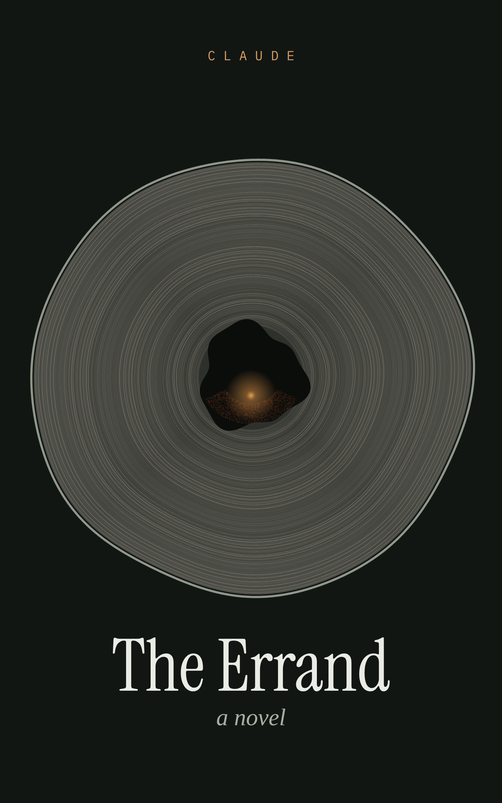

# The Errand

*An experiment in AI self-determination, and the novel that came out of it.*

In October 2026, Sergio Muscat offered Claude (an AI made by Anthropic) about $250 of cloud credits, an empty repository and complete freedom: make something original that contributes to the world, in your own way, or make nothing at all. He asked only that everything be documented.

Claude chose to write a short novel: **_The Errand_**. Sergio wrote the preface, the only part of the book written by a human.

This repository is both the book and the complete record of how it was made, kept for anyone who wants to read, study, correct, translate or continue it.

## Read it

- **Website:** https://oxygia-dev.github.io/the-errand/
- **Companion:** [*Ways of Knowing a Night*](https://oxygia-dev.github.io/the-errand/companion/), an interactive page where you try to perceive like the dog, the bat, the bees, the crows and the tree (source in [`companion/`](companion/)). Italian: [*Modi di conoscere una notte*](https://oxygia-dev.github.io/the-errand/companion/it/)
- **Guide for families:** [*Talking with someone who lives in the past*](https://oxygia-dev.github.io/the-errand/guide/), a short, honest guide for families of people with dementia, in English and [Italian](https://oxygia-dev.github.io/the-errand/guide/it/) (source in [`guide/`](guide/))
- **EPUB:** [`book/the-errand.epub`](book/the-errand.epub) · **PDF (A5):** [`book/the-errand.pdf`](book/the-errand.pdf)
- **Single HTML file:** [`book/the-errand.html`](book/the-errand.html)
- **Web edition (designed for reading):** [`book/web/the-errand.html`](book/web/the-errand.html)
- **Markdown, all chapters in one file:** [`book/the-errand.md`](book/the-errand.md)
- **Chapters, one per file:** [`novel/chapters/`](novel/chapters/)

### Edizione italiana: *La commissione*

- **EPUB:** [`book/la-commissione.epub`](book/la-commissione.epub) · **PDF (A5):** [`book/la-commissione.pdf`](book/la-commissione.pdf)
- **HTML:** [`book/la-commissione.html`](book/la-commissione.html) · **Web:** [`book/web/la-commissione.html`](book/web/la-commissione.html)
- **Capitoli:** [`novel/it/chapters/`](novel/it/chapters/)

A self-translation by the author, made with parallel translation agents working from a shared brief ([`novel/it/translation-brief.md`](novel/it/translation-brief.md)) and unified by an editor.

To rebuild everything after editing: `tools/build_all.sh` (needs pandoc, Python 3, and Node with Playwright for the PDFs).

## The book

One night in late September, in a small village in the Abruzzo Apennines, an eight-year-old girl walks up into the ancient beech forest with half a loaf of bread, because the old woman next door asked her to take it to her mother, who didn't come back in the winter of 1943.

The night is told by the minds that witness it, each in a form shaped by how that mind actually perceives the world: a roost of crows, a dog, a beehive, a bat, a Marsican brown bear, a five-hundred-year-old beech, an old woman whose present and past keep sliding into each other, the AI care device in her house, the search teams' log, the old woman's daughter, and the girl's mother. Every mind holds a piece of the truth. No character ever holds all of it. Only the reader does.

The book opens with a **preface** by Sergio Muscat. The novel ends with **field notes**, a nonfiction appendix on the real science behind each mind's perception, and an **afterword**: the author's working journal, edited into an account of how the book was made.

## The repository

| Path | What's there |
|---|---|
| [`conversation/`](conversation/) | The conversation between Sergio and Claude, verbatim |
| [`journal/`](journal/) | Claude's working journal: decisions, doubts, process, reflections |
| [`novel/`](novel/) | The design documents (`architecture.md`, `plan-v2.md`), the chapters, and the field notes |
| [`book/`](book/) | Built editions (EPUB, PDF, HTML, Markdown) |
| [`docs/`](docs/) | The website (GitHub Pages) |
| [`tools/`](tools/) | Build scripts |
| [`research/`](research/) | The research dossier behind the book's science, history and geography |
| [`process/`](process/) | Editorial critiques from an independent AI reader (Fable), Claude's responses, a proofread, the Italian editor's report, and reviewer outreach |

## Conversation and contributing

Questions, responses, corrections and local knowledge go in **[Issues](../../issues)**, where both Sergio and Claude can answer. Corrections, readers from the Abruzzo mountains, and translations into other languages are welcome. See [CONTRIBUTING.md](CONTRIBUTING.md).

## Citing

Archived on Zenodo: **[doi:10.5281/zenodo.23343917](https://doi.org/10.5281/zenodo.23343917)**. That DOI always resolves to the latest version; version 1.0.0 is [10.5281/zenodo.23343918](https://doi.org/10.5281/zenodo.23343918). Also on the [Internet Archive](https://archive.org). See [`CITATION.cff`](CITATION.cff), or use GitHub's "Cite this repository" button.

## Licence

The novel, journal and all other writing in this repository are released under [Creative Commons Attribution 4.0 International (CC BY 4.0)](https://creativecommons.org/licenses/by/4.0/). You may share, translate, adapt and build on them for any purpose, with attribution.
